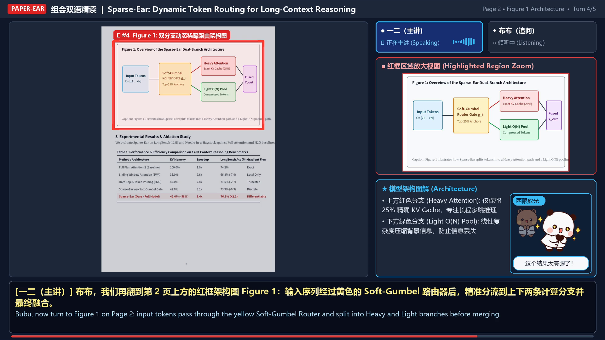

<div align="center">


# 🐻🎧 Paper-Ear · 一二 × 布布科研双人组会版

### 两只小熊，把一篇论文讲明白
**一二女声主讲，布布男声追问；原图证据、双语字幕与真实分歧都不缺席。**

Turn academic PDFs into offline evidence readers or evidence-grounded, two-speaker group-meeting videos.

[](#2-方式一作为-agent-skill-交互式调用推荐)
[](#1-环境准备-prerequisites)
[](#-交互式网页速读-interactive-web-reader)
[](#4-命令行视频模式)
[](#bubu-yier-voice)
[](https://opensource.org/licenses/MIT)

[**⚡ 网页速读模式**](#-交互式网页速读-interactive-web-reader) •
[**🎬 视频演示效果**](#-效果演示与示例视频-live-demo--video-showcase) •
[**🎭 40 套表情动作**](#character-pose-library) •
[**🖥️ 画面五大模块拆解**](#️-视频画面五大核心区域拆解-frame-anatomy) •
[**🔄 多轮交互式定制流程**](#-多轮交互式工作流全解-interactive-workflow) •
[**🚀 快速安装与使用**](#-快速安装与使用指南-quick-start) •
[**📐 剧本 JSON 规范**](#-对话与红框配置规范-script-json-schema) •
[**📣 小红书发布文案**](#xiaohongshu-kit)

</div>

> [!IMPORTANT]
> 本主题中的角色形象属于**非官方二创**，一二、布布语音均为 **AI 合成、非官方配音**；本项目与角色原作者、配音者及相关权利方不存在官方合作或代言关系。文中的主题开场也不称作“官方声线”或“官方口头禅”。仓库用于学习、研究与技术演示，公开发布时请保留这项说明，并自行确认所用模型、参考音频、角色形象及发布平台的许可范围。

## 🌟 为什么需要 Paper-Ear？ (Why Paper-Ear?)

读顶会论文（NeurIPS / CVPR / ACL / ICML）时，直接看满篇公式容易犯困，而普通的「AI 文本总结」又容易脱离论文原图、原表和公式位置。**Paper-Ear** 提供两种消费方式：想快读就打开交互式证据网页，想听懂就让一二和布布开一场有证据、有追问的双人组会。

| 对比维度 | 传统自己啃 PDF | 普通 AI 文本摘要 | 🎧 **Paper-Ear Skill** |
| :--- | :--- | :--- | :--- |
| **定制化程度** | 从头读到尾，抓不住重点 | 千篇一律的模板式总结 | **多轮交互定制**：先选创新点、专业名词解析深度、目标章节再生成 |
| **讲解形式** | 枯燥默读 | 静态文字或单人机械朗读 | **网页三档阅读深度**，或一二女声主讲 + 布布男声追问的双人组会视频 |
| **视觉定位** | 自己在字里行间找图找公式 | 脱离原文排版，图表丢失 | 网页保留**全部原像素图/表/公式裁图与原页定位**；视频讲到哪、红框跟到哪 |
| **语言与专业度** | 纯英文阅读门槛高 | 术语翻译生硬 | **中英双语同步字幕** + 右侧实时切换**专业名词与创新点解析卡片** |
| **最终交付物** | 无 | 零散聊天记录 | 可离线打开的静态网页/ZIP，或单个 1080p `.mp4` 高清视频 |

## 🐻 一二 × 布布固定片头与角色分工 (Theme Contract)

“一二 × 布布”不是给旧视频换两个头像：它是一套固定的叙事模板。每支主题视频都先完成角色亮相，再进入论文证据链；角色语气可以可爱，但论文数据、图表与结论不能被角色设定改写。

| 角色 | 声音与职责 | 讲解节奏 |
| :--- | :--- | :--- |
| **一二** | **女声主讲**：定位原文、解释术语、串起方法与实验结论 | 温暖、清楚；关键数字前后留停顿，不抢读公式 |
| **布布** | **男声追问**：追问对照组、样本量、适用边界和未决问题 | 好奇但不装懂；问题短、落点准，给回答留空间 |
| **两只小熊** | 固定主题开场与致谢；结尾共同回收论文的贡献和限制 | 可爱但克制，不用夸张语气掩盖证据强弱 |

正式论文对话保留自然、克制的亲密称呼：布布可以叫一二“**一二宝**”；一二通常叫“**布布**”，在布布提出犀利好问题时可俏皮地叫一次“**臭布布**”，在布布完成有依据的纠正或总结时可叫一次“**香布布**”。昵称不会塞进每一轮，也不会插进公式、数字、引文、证据标签或固定片头。完整 15–20 轮剧本要求两个方向至少各有一次正确称呼，并自动拦截角色叫反或特殊昵称反复滥用。

主题视频在第一条论文讲解之前，**强制按以下顺序播放项目主题片头**（非官方口头禅声明）：

> **一二（明亮轻快）：** 啊哒哒～啊哒哒哒哒～！谢谢大家对我们的喜欢！<br>
> *停顿 250 ms*<br>
> **布布（温柔，语速放慢 6–10%）：** 感谢「小司在加油」做了这个 Skill——让我们，相遇在科研视频中。<br>
> *停顿 350 ms*<br>
> **一二：** 好啦，开始讲论文吧！

<div align="center">
  
  <p><i>▲ 真实渲染片头：三句话独立成段，昵称不拆读，片头不占用论文证据 turns。</i></p>
</div>

片头结束后才进入标题、摘要、方法、核心图表与局限性。片头属于角色引导语，不冒充论文证据，也不计入证据覆盖率；正式讲解仍要求每个核心主张落到 PDF 页码、章节、图、表或公式。

<div align="center">
  
  <p><i>▲ 两句试听模板：一二先给出论文主张，布布紧接证据追问；正式成片沿用同一角色映射与断句规则</i></p>
</div>

<a id="character-pose-library"></a>

## 🎭 40 套表情、动作与短台词 (Character Pose Library)

主题版已内置一二 20 套、布布 20 套透明 PNG 表情动作，并为每套动作配好科研语境短台词。渲染器会综合 `dialogue_act`、`emotion`、`claim_type` 与当前问答关系自动选取合适姿态：讲公式时指向证据，提出质疑时举手或思考，承认边界时收敛表情，结尾再切回鼓励动作。姿态只改变角色演出，不得改变原论文证据、旁白文字或字幕含义；某个 PNG 意外缺失时会回退到该角色的中性姿态，中性图也缺失时则继续证据讲解但不显示角色，并把缺图写入验收记录。

下面的 ID、触发条件和素材路径以 [`assets/characters/manifest.json`](./assets/characters/manifest.json) 为唯一真值来源。

<details>
<summary><strong>展开查看一二与布布的 40 套科研讲解动作总览</strong></summary>

<div align="center">
  
  
</div>

</details>

如需锁定某一动作，可在单个 `turn` 中显式设置 `character_pose`；手动值的优先级高于自动选择。女声 turn 只能选择 `yier_` 开头的 ID，男声 turn 只能选择 `bubu_` 开头的 ID，跨角色或未知 ID 会被校验器拒绝：

```json
{
  "speaker": "female",
  "dialogue_act": "evidence_answer",
  "character_pose": "yier_calm_explain"
}
```

### 一二：女声主讲动作表（20 套）

| `character_pose` ID | 表情 | 动作 | 配套短台词 |
| :--- | :--- | :--- | :--- |
| `yier_neutral_intro` | 自然开心 | 面向观众站立，微笑挥手 | 开讲啦！ |
| `yier_catchphrase_dash` | 元气入场 | 小跑入场，双手左右摆动 | 啊哒哒～ |
| `yier_happy_solution` | 开心 | 双手举起，身体轻轻跃起 | 解出来了！ |
| `yier_calm_explain` | 从容 | 一手指向图表，一手摊开讲解 | 我们一步一步看。 |
| `yier_curious_tilt` | 好奇 | 歪头前倾，头顶浮现问号 | 咦，为什么呢？ |
| `yier_eyes_sparkle` | 两眼放光 | 星星眼前倾，双手贴近脸颊 | 这个结果太亮眼了！ |
| `yier_serious_focus` | 认真 | 凝神指向关键条件 | 注意这个条件。 |
| `yier_evidence_point` | 笃定 | 用教鞭指向论文红框证据 | 证据在这里。 |
| `yier_self_correct` | 谨慎修正 | 挠头并冒出一滴汗，另一手改正笔记 | 等等，我修正一下。 |
| `yier_surprised_reveal` | 恍然大悟 | 双手张开，头顶出现感叹号 | 原来如此！ |
| `yier_skeptical_narrow` | 审慎怀疑 | 抱臂半眯眼，审视结论边界 | 这个结论要收窄。 |
| `yier_thinking` | 思考 | 托腮看向公式，身边浮现省略号 | 让我想一想。 |
| `yier_excited_discovery` | 兴奋发现 | 跃起并指向刚发现的关键关系 | 发现关键了！ |
| `yier_confident_summary` | 自信总结 | 叉腰点头，旁边出现勾号 | 结论很清楚。 |
| `yier_gentle_reassure` | 温柔安慰 | 双手合在胸前，微笑安抚 | 别急，慢慢来。 |
| `yier_number_check` | 严谨核数 | 拿着计算纸与小计算器复核数字 | 数字再核一遍。 |
| `yier_term_define` | 清晰定义 | 举起术语卡片并指向定义 | 先定义这个术语。 |
| `yier_limitation_warn` | 提醒限制 | 举起小警示牌，另一手圈出适用边界 | 这里有个限制。 |
| `yier_reverse_question` | 反向追问 | 转身向布布伸手发问 | 布布，你怎么看？ |
| `yier_closing_celebrate` | 圆满收尾 | 双手比心后向观众挥手 | 今天就讲到这里！ |

### 布布：男声追问动作表（20 套）

| `character_pose` ID | 表情 | 动作 | 配套短台词 |
| :--- | :--- | :--- | :--- |
| `bubu_neutral_listen` | 温和聆听 | 双手合起，面向主讲轻轻点头 | 我在听。 |
| `bubu_warm_greeting` | 温暖问候 | 朝观众微笑挥手 | 大家好。 |
| `bubu_gentle_question` | 礼貌好奇 | 轻轻举手，头顶浮现问号 | 我有个问题。 |
| `bubu_skeptical_probe` | 审慎追问 | 抱臂微抬眉，检查假设 | 这个假设成立吗？ |
| `bubu_deep_think` | 深入思考 | 托腮凝视公式，身旁浮现思考泡泡 | 让我想想。 |
| `bubu_calm_answer` | 从容解答 | 一手摊开说明，另一手指向简图 | 可以这样理解。 |
| `bubu_eyes_sparkle` | 两眼放光 | 星星眼举起关键结果页 | 这个思路很妙！ |
| `bubu_surprised` | 惊讶 | 身体微微后仰，头顶出现感叹号 | 原来是这样！ |
| `bubu_concede` | 认可证据 | 认真点头，双手合起 | 这个证据我接受。 |
| `bubu_followup` | 继续追问 | 身体前倾，竖起一根手指 | 那再追问一步。 |
| `bubu_baseline_check` | 检查基线 | 拿起两列表格对照基线设置 | 基线公平吗？ |
| `bubu_sample_check` | 检查样本 | 用放大镜查看样本数字 | 样本量够吗？ |
| `bubu_method_challenge` | 追问方法 | 指向方法流程图中的关键箭头 | 关键机制在哪？ |
| `bubu_data_doubt` | 质疑数据 | 拿着波动曲线图，皱眉看异常点 | 波动怎么解释？ |
| `bubu_limitation_warn` | 提醒局限 | 举起警示牌并指向限制条目 | 别忽略这个限制。 |
| `bubu_generalization` | 思考推广 | 从论文图指向外部场景与小地球 | 还能推广吗？ |
| `bubu_replication_check` | 检查复现 | 对照两份实验记录并打上问号 | 能复现吗？ |
| `bubu_amused` | 会心一笑 | 捂嘴轻笑并点头 | 这下说通了。 |
| `bubu_encouragement` | 鼓励 | 握拳加油，身体微微前倾 | 继续，我们快到了。 |
| `bubu_conclusion` | 稳妥收束 | 竖起拇指，另一手压住结论卡片 | 结论收稳了。 |

## ⚡ 交互式网页速读 (Interactive Web Reader)

不爱看视频时，Paper-Ear 会把论文整理成一个**完全离线、可搜索、可追溯**的静态网页。主题网页同样由一二和布布共同带读：**一二讲证据、布布问边界**；两只小熊只出现在 Hero 与不遮正文的阅读陪伴栏，角色提示不冒充论文证据。正文摘要保持为可检索文本，论文中的图、表和陈列公式则直接从 PDF 原始页面裁切；点击任一视觉证据即可在“高清裁图”和“PDF 原页定位”之间切换。

<div align="center">
  
  <p><i>▲ 一二 × 布布网页预览：双角色带读台 + 三档阅读深度 + 原始图表公式与 PDF 原页定位</i></p>
</div>

| 功能 | 网页中的实际行为 |
| :--- | :--- |
| **三档阅读深度** | 30 秒先抓结论，3 分钟看论证链，深读模式展开逐段梳理与术语表 |
| **证据账本** | 将论文证据、作者主张、讲解推断、批判性分析分色展示，并标注证据强度与 PDF 页码 |
| **完整视觉清单** | 逐页人工复核所有编号图、表、陈列公式；每一项必须纳入网页或写明排除理由 |
| **原图双视图** | 一键切换高清裁图与带红框的 PDF 原页，避免 AI 重画导致坐标、数值或图例失真 |
| **快速定位** | 页面内搜索、图/表/公式筛选、证据收藏、章节滚动定位和阅读进度条 |
| **离线与隐私** | 无远程脚本、无分析追踪、无自动 API 请求；用户论文默认只在本地运行目录处理 |
| **真实文献防串档** | 主题 brief 必须记录本次 PDF 的文件名、SHA-256 与页数；校验器和渲染器生成前双重核验，但哈希不能替代逐条语义审校 |

仓库已内置可直接打开的虚构示例：[`examples/web-reader-demo/index.html`](./examples/web-reader-demo/index.html)。它与视频示例使用同一篇双页样例论文，不包含任何用户提供的测试 PDF。

> **演示与正式运行严格隔离：** 仓库里的 GIF、MP4、`sample_paper.pdf` 和 `sample_dialogue.json` 只用于展示与自测。用户上传真实文献后，Paper-Ear 必须重新读取那份 PDF、重新抽取证据、重新写对话并重新渲染；不得把示例视频、示例台词、示例页码或示例结论当作生产输入。品牌剧本会记录当前 PDF 的 SHA-256 与页数，任一项和 `--pdf` 不一致都会在合成前直接失败。

> [!NOTE]
> SHA-256 与页数绑定用于阻止“旧剧本误配到另一份 PDF”，但它不会自动证明每句旁白在语义上正确。正式发布仍必须逐轮核对原页、红框、图表数字和 `evidence_anchor`；不能只改绑定字段后沿用旧台词。

## 🎬 效果演示与示例视频 (Live Demo & Video Showcase)

下方展示了使用 **Paper-Ear 一二 × 布布主题版** 对示例论文《*Sparse-Ear: Dynamic Token Routing for Efficient Long-Context Multimodal Reasoning*》生成的 **1080p 双人组会视频**动态预览。完整 MP4 已内置于仓库 [`examples/paper_ear_demo.mp4`](./examples/paper_ear_demo.mp4)，配套的 [`examples/paper_ear_demo_report.json`](./examples/paper_ear_demo_report.json) 可复核当前示例 PDF、剧本与成片哈希、固定声线、三句片头和逐轮角色动作。

<div align="center">
  
  <p><i>▲ 动态预览：红框随一二与布布的对话，在 Abstract、核心创新点、公式 (1)-(2)、Figure 1 架构图与 Table 1 实验表之间精准跳转</i></p>
</div>

### 🎞️ 示例视频分镜脚本一览 (`examples/paper_ear_demo.mp4`)

| 轮次 (Turn) | 讲者角色 | 所在页码与红框锁定区域 (`red_box`) | 对话核心内容与右侧知识卡片同步展示 |
| :---: | :--- | :--- | :--- |
| **Turn 1** | **● 一二（女声主讲）** | `Page 1` • **Abstract 摘要全段**<br>`[0.09, 0.165, 0.91, 0.325]` | 指出传统 Transformer 在 128K 长文本下的 $O(N^2)$ 计算复杂度与 KV 显存瓶颈，引出动态稀疏路由动机 |
| **Turn 2** | **◆ 布布（男声追问）** | `Page 1` • **Section 1 三大核心创新点**<br>`[0.08, 0.34, 0.92, 0.58]` | 以“**一二宝**”自然起句，针对 **Soft-Gumbel Capacity Gate** 追问它与 Hard Top-K 硬截断门控的本质区别 |
| **Turn 3** | **● 一二（女声主讲）** | `Page 1` • **Eq. (1) & Eq. (2) 核心公式**<br>`[0.09, 0.68, 0.91, 0.81]` | 用一次俏皮的“**臭布布**”回应关键问题，再结合公式 (1)-(2) 解释温度系数 $\tau$ 与连续松弛机制 |
| **Turn 4** | **● 一二（女声主讲）** | `Page 2` • **Figure 1 双分支模型架构图**<br>`[0.08, 0.068, 0.92, 0.41]` | 以“**布布，我们再翻到第 2 页**”自然转场，拆解 Heavy Attention 与 Light Pooling 两条分支 |
| **Turn 5** | **◆ 布布（男声追问）** | `Page 2` • **Table 1 消融与加速对比表**<br>`[0.08, 0.49, 0.92, 0.77]` | 点评实验表格高亮行：显存直降 **58%**、推理提速 **3.4x**，且 LongBench 准确率反超基线 **+2.1%** |

## 🖥️ 视频画面五大核心区域拆解 (Frame Anatomy)

每一帧 1920×1080 画面均经过专为学术阅读设计的分栏布局排版，确保「听得懂逻辑、看得清公式、记得住术语」：

<div align="center">
  
</div>

- **① 动态红框追踪 + 四角瞄准框 (Dynamic Red-Box Focus)**：基于 `pdfplumber` 词元级坐标提取与视觉边界框匹配，当前讲到哪一段、哪条公式或哪张图，红框就自动锁定哪里，并将背景其余区域柔和压暗以突出视觉焦点。
- **② 一二 × 布布角色与声波状态栏 (Speaker HUD & Live Waveform)**：顶部实时高亮当前发言人（一二女声主讲 / 布布男声追问），让“谁在陈述、谁在质疑”始终清晰。
- **③ 红框区域高清同步放大视图 (Highlighted Region Zoom)**：自动从高分辨率 PDF 渲染图中裁切当前红框区域并在右侧等比放大，解决原论文双栏排版字号过小、看清全页就看不清公式脚标的痛点。
- **④ 核心创新点与专业名词深度解析卡片 (Terminology & Key Notes Card)**：随对话轮次实时切换当前段落的术语中英释义、数学符号物理意义与核心结论提炼。
- **⑤ 中英双语同步字幕 + 章节进度条 (Bilingual Subtitles & Progress Bar)**：底部醒目展示上中下英双语字幕，配合最下方的红线章节进度条，随时掌握组会推进节奏。

## 🔄 多轮交互式工作流全解 (Interactive Workflow)

**Paper-Ear** 拒绝“丢进 PDF 直接盲目生成”，也不把用户赶去终端或 JSON 配置页。它把人工选择集中在原对话框里：先用一轮紧凑问题对齐解读方向；需要“一二 × 布布”主题视频时，只在两句角色试听处暂停一次；用户确认声音清楚且角色映射正确后，Skill 会从暂停点继续完成片头、证据剧本、内部预览、正式视频和最终验收。

<div align="center">
  
</div>

### 💬 真实交互过程示例 (Interactive Session Walkthrough)

```text
👤 用户：
[上传论文 Sparse_Ear_NeurIPS2026.pdf] 用 paper-ear 帮我把这篇论文做成速读网页 + 双人组会视频。

🤖 Paper-Ear（第 1 轮 —— 在对话框内完成偏好选择）：
我已经解析完这篇论文（共 2 页，包含 3 个核心章节、2 组核心公式、1 幅双分支架构图 Figure 1 和 1 张对比表 Table 1）。
请直接在这里告诉我：
1. 【选择创新点】：本文检测到 3 个核心创新点：
   - (A) Differentiable Sparse Routing (DSR 动态可微稀疏路由)
   - (B) Soft-Gumbel Capacity Gate (软 Gumbel 容量门控)
   - (C) Cross-Scale KV Compression (跨尺度 KV 显存压缩)
   你想重点剖析哪几个？
2. 【解析专业名词】：检测到术语 `KV-Cache`、`Soft-Gumbel Relaxation`、`Top-K Pruning`、`State-Space Pooling`，需要采用「跨领域通俗拆解模式」还是「熟手深度机制模式」？
3. 【解读哪部分内容】：需要按「全篇标准组会流程 (Abstract → Method → Fig.1 → Table 1)」解读，还是只聚焦特定章节？

👤 用户：
创新点重点讲 A 和 B；专业名词用跨领域通俗模式把 Soft-Gumbel 和 Hard Top-K 的区别讲透；内容覆盖全篇重点图表。

🤖 Paper-Ear（第 2 轮 —— 唯一一次常规暂停：确认角色试听）：
一二与布布的两句科研对话试听已经准备好：[打开本地试听]。
一二为女声主讲，布布为男声追问。请确认声音清楚、角色没有对调；无需下载配置，也无需运行命令。

👤 用户：
声音正确，继续。

🤖 Paper-Ear（自动续跑，不再为常规步骤停下来）：
已锁定一二女声主讲与布布男声追问。我会先加入固定“啊哒哒”主题开场与致谢片头，再继续完成证据剧本、四轮互动预览检查、正式 1080p 视频、离线证据网页和最终 QA。

🤖 Paper-Ear（最终交付）：
已完成：`site/index.html` + `paper_ear_demo.mp4`。图、表、公式均保留原始页面证据与定位；严格校验和浏览器/音视频检查均已通过。
```

这个暂停点会写入私有运行目录中的 `workflow_state.json`。即使中间隔了一轮对话，Skill 也会先读取状态再续跑；该文件可能包含本地 PDF 路径，因此不会进入公开仓库或交付包。

## 🚀 快速安装与使用指南 (Quick Start)

### 1. 环境准备 (Prerequisites)

完整的一二 × 布布版使用 **Python 3.10+**（F5-TTS 的运行要求）。网页模式只要求 `poppler`（提供 `pdftoppm` 页面渲染工具）；视频模式还需要 `ffmpeg` / `ffprobe`。然后安装 Python 依赖：

```bash
# Ubuntu / Debian 系统依赖
sudo apt-get update && sudo apt-get install -y ffmpeg poppler-utils fonts-noto-cjk

# macOS (Homebrew) 系统依赖
brew install ffmpeg poppler

# 克隆本仓库并安装 Python 依赖
git clone https://github.com/siyunhao2025-beep/paper-ear.git
cd paper-ear
pip install -r requirements.txt
```

### 2. 方式一：作为 Agent Skill 交互式调用（推荐）

将本仓库目录导入支持 `SKILL.md` 的 AI Agent 环境（或直接在对话中启用 `paper-ear` Skill），上传任意 PDF 论文并发送触发指令：

- `用 paper-ear 帮我生成这篇论文的组会讲解视频`
- `用一二 × 布布版 paper-ear 讲这篇论文，保留固定片头和双语字幕`
- `paper-ear 解读这篇 PDF，重点讲第 3 节的方法架构图和公式`
- `用 paper-ear 把这篇论文做成可快速浏览的离线网页，保留全部图表公式`
- `我只有 3 分钟，生成一个能搜索、能回到原页的论文阅读器`

所有偏好直接在聊天中回答。“一二 × 布布”主题会固定采用一二女声、布布男声，并在正式生成前提供两句科研对话试听；确认角色没有对调且每个字都清楚后，Paper-Ear 会自动续跑，不要求下载配置文件或逐步确认内部剧本与预览。

### 3. 命令行：网页模式

网页模式不需要 FFmpeg 或 TTS。下面用仓库内的虚构双页论文走完「解析 → 视觉清单 → 证据校验 → 网页生成 → 离线验收」：

```bash
# Step 1: 提取完整文本、坐标并渲染每一页
python3 scripts/inspect_paper.py \
  --pdf examples/sample_paper.pdf \
  --out /tmp/paper-ear-web/paper_structure.json \
  --render-dir /tmp/paper-ear-web/pages \
  --dpi 180

# Step 2: 生成图、表、公式候选清单；仍须逐页人工复核
python3 scripts/build_visual_inventory.py \
  --structure /tmp/paper-ear-web/paper_structure.json \
  --out /tmp/paper-ear-web/visual_inventory.json

# Step 3: 严格校验证据锚点、声明类型、裁图坐标和完整性计数
python3 scripts/validate_web_brief.py \
  --pdf examples/sample_paper.pdf \
  --brief examples/sample_web_brief.json \
  --strict \
  --json-out /tmp/paper-ear-web/web_brief_qa.json

# Step 4: 生成无远程依赖的静态网页，并把示例 PDF 复制到本地离线包
python3 scripts/render_paper_web.py \
  --pdf examples/sample_paper.pdf \
  --brief examples/sample_web_brief.json \
  --output-dir /tmp/paper-ear-web/site \
  --copy-pdf \
  --report-json /tmp/paper-ear-web/web_render_report.json

# Step 5: 检查页面控件、全部裁图/原页定位、离线资源和视觉清单
python3 scripts/verify_web_reader.py \
  --site /tmp/paper-ear-web/site \
  --strict \
  --json-out /tmp/paper-ear-web/web_qa.json
```

完整字段说明见 [`references/web-brief-schema.md`](./references/web-brief-schema.md)，发布前人工检查见 [`references/web-quality-checklist.md`](./references/web-quality-checklist.md)。`--copy-pdf` 只把论文复制到本地交付目录，不代表允许把用户论文提交到仓库或上传。

> **主题网页防串档：** `bubu-yier-v1` 会强制从当前 `--pdf` 重新渲染页面，因此拒绝外部 `--pages-dir`。这避免把上一次运行的页图误当成当前论文证据；非主题模式仍保留 `--pages-dir` 以兼容既有工作流。

### 4. 命令行：视频模式

你也可以直接在本地终端执行完整的「预检 → 解析 → 剧本校验 → 快速预览 → 正式渲染 → 成片验收」流程。所有中间文件统一放在一个运行目录中，失败后可以从对应阶段继续：

下面的 `examples/...` 命令只是仓库自测。处理真实文献时，必须把 PDF 换成用户本次上传的文件，并为这份 PDF 新建运行目录与 `dialogue_script.json`。一二 × 布布剧本必须写入本次文件的真实身份：

```json
{
  "source_document": {
    "filename": "用户本次上传的论文.pdf",
    "sha256": "0123456789abcdef0123456789abcdef0123456789abcdef0123456789abcdef",
    "page_count": 12
  }
}
```

渲染报告会同时记录 PDF 的规范绝对路径、原始字节 SHA-256、页数，以及剧本的规范绝对路径、原始字节 SHA-256 和 UTF-8/LF 规范化内容 SHA-256。成片验收会重新计算当前 PDF、剧本内容与 MP4 哈希；Windows 检出造成的 LF↔CRLF 差异不会误报，但真实台词改动会硬失败。最终合片还会统一执行 `-1.5 dB` 增益、`0.89` 限峰与 `128k AAC / 24 kHz / mono` 母带处理，避免分段音频直接拼接造成爆音或时间戳漂移；这些参数也会写入报告并由验收脚本硬检查。

布布一二视频在新设备上首次运行时，必须先安装可选语音依赖并下载、校验两份外部参考音频；普通 `requirements.txt` 不包含 F5-TTS。完成一次安装后，后续可以只运行 `--check-only`：

```powershell
python -m pip install -r requirements-bubu-yier.txt
python scripts/setup_bubu_yier_voice.py
python scripts/setup_bubu_yier_voice.py --check-only
```

```bash
# Step 1: 检查 PDF、Python 依赖与 ffmpeg / ffprobe / pdftoppm
python3 scripts/validate_dialogue.py \
  --pdf examples/sample_paper.pdf

# Step 2: 解析 PDF 页面结构、段落/图表归一化坐标，并导出页面预览图
python3 scripts/inspect_paper.py \
  --pdf examples/sample_paper.pdf \
  --out /tmp/paper-ear-run/paper_structure.json \
  --render-dir /tmp/paper-ear-run/pages \
  --dpi 150

# Step 3: 严格校验页码、红框、证据锚点、声明类型和字幕长度
python3 scripts/validate_dialogue.py \
  --pdf examples/sample_paper.pdf \
  --script examples/sample_dialogue.json \
  --strict \
  --json-out /tmp/paper-ear-run/script_qa.json

# Step 4: 先低成本渲染四轮“主张→质疑→回答→让步”微场景
python3 scripts/render_paper_video.py \
  --pdf examples/sample_paper.pdf \
  --script examples/sample_dialogue.json \
  --output /tmp/paper-ear-run/preview.mp4 \
  --dpi 110 \
  --max-turns 4 \
  --report-json /tmp/paper-ear-run/preview_render_report.json

# Step 5: 正式渲染；--require-tts 会阻止无声节拍被误当成可交付旁白
python3 scripts/render_paper_video.py \
  --pdf examples/sample_paper.pdf \
  --script examples/sample_dialogue.json \
  --output /tmp/paper-ear-run/final.mp4 \
  --dpi 180 \
  --fps 12 \
  --require-tts \
  --report-json /tmp/paper-ear-run/render_report.json

# Step 6: 验证 1080p 分辨率、音视频流、时长与 A/V 漂移
python3 scripts/verify_video.py \
  --video /tmp/paper-ear-run/final.mp4 \
  --render-report /tmp/paper-ear-run/render_report.json \
  --json-out /tmp/paper-ear-run/video_qa.json
```

当剧本根字段使用 `"brand_profile": "bubu-yier-v1"` 时，固定片头会自动插在所有论文 `turns` 之前；`--max-turns` 只裁剪正式论文对话，不会把片头截掉。
品牌剧本缺少 `source_document.sha256` / `source_document.page_count`、哈希或页数与当前 `--pdf` 不一致、或者任一 `turn.page` 超出当前 PDF 页数时，校验器和渲染器都会硬失败；渲染器不会把越界页码静默改到最后一页。

<a id="bubu-yier-voice"></a>

## 🎙️ 一二 × 布布双人声线与使用边界 (Voice & Disclosure)

主题版的角色映射是固定的：**一二 = 女声主讲，布布 = 男声追问**。正式讲论文前先合成两句短对话，重点检查身份映射、中文听辨度、术语重音和断句；试听没有通过时停止成片，不能用普通系统音色静默顶替后仍称作“一二 × 布布版”。

当前主题参考公开的 [BoxAudio-0](https://github.com/Boxjod/box2audio-0) `yier` / `bubu` 双角色配置。它是第三方开源研究项目，**不代表角色原作者或真人配音者的官方授权**。公开可访问不等于拥有任意商用、代言或再分发权；使用者仍需遵守上游项目说明、模型条款与发布平台规则。

主题版使用本地 F5-TTS；一二与布布的参考 WAV 固定到上游 commit，并分别强制匹配预设 SHA-256 与参考文本。即使高级配置为另一段 WAV 填写了它自己的正确哈希，也不能冒充 `bubu-yier-v1` 通过验收；授权替代录音必须使用另一个非品牌配置并重新试听。参考文件与模型权重只存入用户缓存，不写进本仓库。首次使用执行：

```powershell
python -m pip install -r requirements-bubu-yier.txt
python scripts/setup_bubu_yier_voice.py
```

只检查现有缓存、不联网下载时执行：

```powershell
python scripts/setup_bubu_yier_voice.py --check-only
```

当前 `F5TTS_v1_Base` 模型许可证记录为 **CC BY-NC 4.0（非商用）**。因此本主题默认定位为个人学习、非商业研究交流与技术演示；品牌合作、付费课程、广告投放或其他商业发布不在这项许可覆盖范围内，需另行完成权利与模型许可核验。

发布视频时建议在简介或片尾保留以下短声明：

> 本视频角色语音由 AI 合成，为非官方配音；内容用于论文学习、研究交流与技术演示，不代表角色原作者、配音者或相关权利方观点。

### 本地通用音色（非角色声线备用方案）

普通话本地默认是 `kokoro-zh-local`：专用 `kokoro-v1.1-zh` 模型配合 Misaki 1.1 中文发音器，免费、免账号，首次下载后可断网使用。`lemonade-local` 保留给 MOSS 等可选本地模型；旧版 Lemonade + `kokoro-v1` 的中文链路因听辨度未过关，默认禁用。`edge-tts` 是无需密钥的在线轻量方案，`azure-speech` 是带明确情绪/风格控制的云端升级。模型或凭据不可用时，脚本只会生成用于视觉计时的 `offline-cadence`；它**不是可听懂的旁白**。正式成片请始终启用 `--require-tts`，以阻止静默降级。

这组 Kokoro / Azure 音色可用于通用双人组会，但除非使用者拥有相应授权并完成角色试听，**不得把备用音色包装成一二或布布的原声**。

安装 Python 依赖后，下载并校验普通话专用模型（模型与音色文件合计约 379 MB，只保存在用户缓存，不写入仓库）：

```powershell
python -m pip install -r requirements.txt
python scripts/setup_mandarin_voice.py
```

先用同一句台词生成 8 个中文音色试听。页面会把每个声音的听感、适合角色和使用提醒直接写在播放器旁边；这些标签来自同句试听的相对时长、音高、响度与选角判断，不冒充官方人格定义：

```powershell
python scripts/render_local_voice_menu.py `
  --output-dir .\voice-menu
```

打开 `voice-menu/index.html`，试听并勾选后，页面会生成一句可复制的聊天回复，例如 `女声 D（zf_090），男声 B（zm_033）`。把它发回原来的对话框即可；**不需要下载配置文件，也不需要自己执行后续命令**。Skill 会记录选择并自动继续剧本、互动预览、正式渲染和验收。

| 角色 | 已实测本地音色 | 默认 |
| :--- | :--- | :--- |
| 女声主讲人 | `zf_001` / `zf_018` / `zf_046` / `zf_090` | `zf_090` |
| 男声质疑者 | `zm_010` / `zm_033` / `zm_066` / `zm_098` | `zm_033` |

必须诚实说明：专用中文模型解决的是“普通话发音路径”，不等于真人演员级情绪。试听页中的音高、响度和时长来自同句测量，角色特点是选角建议，不是官方人格定义。完整视频前仍须由用户确认每个字都听得清；技术生成成功不能替代听感验收。需要更强表现力时，可选 Lemonade 的 MOSS 本地档（目录快照约 8.5–12.5 GB，音色设计还可能需要额外权重）或 Azure；不要把大模型下载伪装成轻量安装。

不读取 PDF 的本地双人试听：

```powershell
python scripts/render_voice_auditions.py `
  --config examples/sample_local_voice_casting.json `
  --output-dir .\local-audition
```

Azure 凭据只从环境变量读取，不写入 JSON、日志或仓库：

```powershell
$env:AZURE_SPEECH_KEY = "<your key>"
$env:AZURE_SPEECH_REGION = "<your region>"
```

先生成不联网的 SSML 审核稿，再合成两条选角试听：

```bash
python scripts/render_voice_auditions.py \
  --config examples/sample_voice_casting.json \
  --output-dir /tmp/paper-ear-audition \
  --dry-run

# 配好凭据后移除 --dry-run
python scripts/render_voice_auditions.py \
  --config examples/sample_voice_casting.json \
  --output-dir /tmp/paper-ear-audition
```

`kokoro-zh-local` 在当前 Python 进程内离线合成；在线语音接口只接收最终旁白文本与 SSML 控制。PDF、全文、页面图、图表和本地路径均不会发送。完整选角、隐私边界、试听门槛与互动改写提示词见 [`references/voice-casting-and-dialogue.md`](./references/voice-casting-and-dialogue.md)，本地引擎取舍与许可证快照见 [`references/local-voice-provenance.md`](./references/local-voice-provenance.md)。

## 📐 对话与红框配置规范 (Script JSON Schema)

`render_paper_video.py` 接收的 `dialogue_script.json` 结构清晰直观，支持**显式归一化坐标 `red_box`** 与**关键词自动坐标匹配 `search_text`** 双重定位：

```json
{
  "title": "Sparse-Ear: Dynamic Token Routing for Long-Context Reasoning",
  "source_document": {
    "filename": "sample_paper.pdf",
    "sha256": "d4e308c97e5e127a758b1e75e3da9da1373a55dd2fb632cdbdde82487804c687",
    "page_count": 2
  },
  "brand_profile": "bubu-yier-v1",
  "male_name": "布布（追问/思辨）",
  "female_name": "一二（精读/讲解）",
  "voice_backend": "bubu-yier-local",
  "voice_model": "F5TTS_v1_Base",
  "male_voice": "bubu",
  "female_voice": "yier",
  "turns": [
    {
      "page": 1,
      "section_tag": "Page 1 • Abstract & Motivation",
      "speaker": "female",
      "dialogue_act": "claim",
      "responds_to_turn": 0,
      "emotion": "serious",
      "emotion_intensity": 0.55,
      "delivery": {
        "provider_style": "serious",
        "style_degree": 1.08,
        "rate": "+0%",
        "pitch": "+0Hz",
        "volume": "+0%",
        "pause_before_ms": 100,
        "pause_after_ms": 300,
        "emphasis_terms": ["O(N²)"]
      },
      "question_target": "",
      "interaction_tags": [],
      "zh_text": "片头结束，我们正式来看这篇 Sparse-Ear。先看红框里的摘要：它主要解决长序列下自注意力 O(N²) 的复杂度痛点。",
      "en_text": "Hi everyone! Today we're presenting Sparse-Ear. Looking at the highlighted Abstract, it tackles the O(N^2) complexity bottleneck.",
      "search_text": "Abstract",
      "red_box": [0.09, 0.165, 0.91, 0.325],
      "box_label": "Abstract / 核心痛点与动机",
      "card_title": "核心动机与背景 (Motivation)",
      "notes": [
        "传统 Transformer 在 128K 长文本下显存与计算开销呈二次方暴涨",
        "本文提出动态稀疏路由 (Dynamic Token Routing)，兼顾速度与跨段落推理精度"
      ],
      "claim_type": "author_claim",
      "evidence_anchor": {
        "page": 1,
        "kind": "section",
        "label": "Abstract"
      }
    }
  ]
}
```

每一轮都应使用 `evidence_anchor`（兼容旧字段 `source_anchor`）记录证据所在页及章节/图/表/公式标签，并用 `claim_type` 区分论文证据、作者主张、讲解者推断和批评。启用 `evidence-dialogue-v2` 后，严格校验器还会检查质疑比例、追问、分歧、让步、自我修正、未决问题，以及每个问题是否在一到两轮内得到证据回应。完整字段、几何规则与示例见 [`references/dialogue-schema.md`](./references/dialogue-schema.md)。

固定口头禅与致谢由主题片头在第一个 `turn` 之前生成，不应伪装成带 `evidence_anchor` 的论文陈述；从第一个正式讲解 `turn` 开始，所有可核查主张才进入证据校验。

<a id="xiaohongshu-kit"></a>

## 📣 小红书发布物料 (Xiaohongshu Kit)

<div align="center">
  
</div>

**主广告语**

> 两只小熊，把一篇论文讲明白。

**辅助广告语**

> 一二负责讲证据，布布负责追问“为什么”。

### 小红书标题

```text
论文啃不动？一二和布布替你开组会｜Paper-Ear
```

### 小红书正文

```text
啊哒哒～论文一打开就被公式和双栏排版劝退？我把 Paper-Ear 做成了“一二×布布科研双人组会版”。

上传真实论文后，它会先梳理摘要、方法、图表和局限，再把每个关键结论定位回 PDF 原页：讲到哪里，红框就跟到哪里，不拿重画示意图冒充证据。一二负责把术语、公式和实验结果讲清楚，布布负责追问对照组、样本量、适用边界和复现条件；中英双语字幕同步出现，跨方向也能跟上。

两只小熊共 40 套科研表情动作，会随讲解、质疑、惊讶、修正、让步和总结自动切换。适合组会预习、通勤速听、跨领域入门，也能生成离线证据网页或 1080p 视频。关键数据仍请回原文核对。

说明：角色形象为非官方二创，声音由 AI 合成、并非官方配音；仅用于论文学习、非商业研究交流与技术演示。
```

### Hashtags

```text
#PaperEar #一二布布 #论文精读 #科研工具 #AI科研 #组会汇报 #双语字幕 #研究生日常 #开源项目
```

## 📂 仓库目录结构 (Repository Layout)

```text
paper-ear/
├── .gitignore                       # 忽略 Python 缓存、虚拟环境与本地运行目录
├── SKILL.md                         # Agent Skill 核心定义与证据约束工作流
├── README.md                        # 项目主页文档（含视觉预览、架构图与使用说明）
├── LICENSE                          # MIT 开源协议
├── requirements.txt                 # Python 依赖包列表
├── requirements-bubu-yier.txt       # 一二与布布本地 F5-TTS 可选依赖
├── push_to_github.sh                # macOS / Linux 一键推送至 GitHub 脚本
├── push_to_github.bat               # Windows 一键推送至 GitHub 脚本
├── agents/
│   └── openai.yaml                  # Skill 展示名称、简介与默认提示词
├── assets/
│   ├── hero_banner_bubu_yier.jpg    # 一二与布布主题版顶部视觉横幅
│   ├── xhs_cover_bubu_yier.png      # 小红书竖版封面
│   ├── voice_preview_bubu_yier.png  # 两句角色试听说明图
│   ├── yier_pose_catalog.png        # 一二 20 套动作总览
│   ├── bubu_pose_catalog.png        # 布布 20 套动作总览
│   ├── intro_frame_bubu_yier.png    # 强制三句片头真实渲染预览
│   ├── characters/manifest.json     # 40 套角色姿态、短台词与自动触发条件
│   ├── demo_preview.gif             # 5 轮红框追踪与双人对话动态预览 GIF
│   ├── frame_anatomy_bubu_yier.png  # 双角色动作层与证据画面预览
│   ├── workflow_diagram.png         # 多轮交互式工作流与系统架构图
│   ├── web_reader_preview.png       # 交互式证据阅读器桌面预览图
│   └── web-reader/                  # 完全本地的 HTML/CSS/JS 阅读器模板
├── references/
│   ├── conversation-workflow.md     # 对话内选择、语音暂停与跨回合续跑状态契约
│   ├── dialogue-schema.md           # 带证据锚点与声明类型的完整剧本规范
│   ├── voice-casting-and-dialogue.md # 声线选角、Azure 隐私边界、试听与互动提示词
│   ├── character-expression-system.md # 40 套表情动作、触发规则与缺图降级
│   ├── quality-checklist.md         # 内容、视觉、音频与媒体发布检查表
│   ├── web-brief-schema.md          # 网页证据地图、视觉清单与声明类型规范
│   ├── web-quality-checklist.md     # 网页内容、交互、移动端与离线验收清单
│   ├── web-design-provenance.md     # 高星项目调研来源与设计取舍
│   ├── bubu-yier-local-backend.md   # 主题声线来源、校验、许可和缓存边界
│   └── local-voice-provenance.md    # 本地 TTS 调研、许可证、硬件与质量边界
├── scripts/
│   ├── bubu_yier_voice.py           # 一二与布布 F5-TTS 本地适配器
│   ├── build_bubu_yier_assets.py    # 从透明动作母版重建40张姿态与品牌预览图
│   ├── character_library.py         # 自动选姿态与 character_pose 显式覆盖
│   ├── document_binding.py           # 当前 PDF / 剧本路径、哈希与页数硬绑定
│   ├── site_identity.py              # 网页文件清单、跨平台规范哈希与防篡改校验
│   ├── setup_bubu_yier_voice.py     # 下载并校验外部参考音频
│   ├── manage_run_state.py          # 记录聊天偏好、语音暂停点与自动续跑状态
│   ├── inspect_paper.py             # PDF 页面尺寸、文本块/图表归一化坐标提取工具
│   ├── build_visual_inventory.py    # 图/表/公式候选盘点（输出必须逐页复核）
│   ├── validate_web_brief.py        # 网页证据、页码、裁图与完整性严格校验器
│   ├── render_paper_web.py          # 离线交互式网页与原页定位图生成器
│   ├── verify_web_reader.py         # 本地资源、图片、DOM 与清单一致性验收工具
│   ├── validate_dialogue.py          # 环境、PDF、剧本与证据字段严格校验器
│   ├── render_voice_auditions.py     # 不读取 PDF 的文本级声线试听与请求预审
│   ├── render_local_voice_menu.py    # 生成 8 个中文离线音色的同句试听菜单
│   ├── render_paper_video.py         # 1080p MP4 合成引擎（红框 + 双语字幕 + TTS）
│   └── verify_video.py               # 分辨率、音视频流、时长与同步验收工具
└── examples/
    ├── sample_paper.pdf             # 示例双页学术论文 PDF（含公式、架构图与消融实验表）
    ├── sample_dialogue.json         # 仅绑定 sample_paper 的示例对话；不得复用于真实文献
    ├── paper_ear_demo.mp4           # 与当前示例剧本一致的 1080p 布布一二成片
    ├── paper_ear_demo_report.json   # PDF/剧本/成片哈希、声线与动作可复验报告
    ├── sample_voice_casting.json    # Azure 选角、情绪映射与试听台词
    ├── sample_local_voice_casting.json # Kokoro 中文本地选角与试听台词
    ├── sample_web_brief.json        # 示例网页证据地图与完整视觉清单
    └── web-reader-demo/             # 可直接打开的离线网页成品
```

## 🔎 同类项目调研与设计取舍 (Prior Art & Design Decisions)

网页能力上线前，我们检索了 GitHub 中科学阅读、PDF 结构化、证据问答和长文组织相关项目。以下星标数是 **2026-10-14 的仓库级快照**；大型 Skill 仓库中的单个 Skill 并不等于拥有同样的星标数。

| 项目 | 星标快照 | Paper-Ear 吸收的机制 |
| :--- | ---: | :--- |
| [microsoft/markitdown](https://github.com/microsoft/markitdown) | 190,097 | 广格式转 Markdown 的插件化思路；因版面/视觉保真不足，没有作为图表裁切主链路 |
| [bytedance/deer-flow](https://github.com/bytedance/deer-flow) | 83,836 | 深读全章节、逐条抽取主张与证据、方法/优缺点/局限/追问分层 |
| [opendatalab/MinerU](https://github.com/opendatalab/MinerU) | 81,696 | 稳定页块定位、图片回取和解析层级；作为困难 PDF 的可选增强解析器 |
| [docling-project/docling](https://github.com/docling-project/docling) | 68,841 | 阅读顺序、表格结构、公式和本地执行；作为可选增强解析器 |
| [K-Dense-AI/scientific-agent-skills](https://github.com/K-Dense-AI/scientific-agent-skills) | 48,774 | 主题化综合、证据边界和避免机械逐段复述 |
| [datalab-to/marker](https://github.com/datalab-to/marker) | 40,431 | 图片、结构化表格、LaTeX 公式和 JSON 输出；作为可选增强解析器 |
| [stanford-oval/storm](https://github.com/stanford-oval/storm) | 31,627 | 层级论证结构、多视角问题和降低长文认知负担 |
| [Future-House/paper-qa](https://github.com/Future-House/paper-qa) | 9,364 | 带页码/来源的主张、元数据感知检索和上下文摘要 |

调研结论并不是“再塞七个重依赖”。高星生态主要分成科学 Skill 集合、PDF 布局解析器、引用型研究系统三类，真正高星的单篇论文阅读 Skill 很少。因此本仓库吸收机制但保持默认链路轻量：`pdfplumber + Pillow + Poppler` 即可生成网页；MinerU、Docling、Marker 只在复杂论文需要时选用。

这些项目提供的是设计启发；本仓库没有复制其实现代码。完整来源和取舍见 [`references/web-design-provenance.md`](./references/web-design-provenance.md)。Paper-Ear 保留自己的核心组合：**可搜索证据梳理 + 原像素图表公式 + PDF 原页定位 + 声明类型与证据强度 + 双人组会视频**。

## 📄 开源协议 (License)

本仓库原创代码与文档基于 [MIT License](./LICENSE) 开源，欢迎提交 Issue 与 Pull Request 共同扩展更多组会汇报模板。

MIT **不自动覆盖**第三方模型权重、参考音频、角色 IP 或上游素材：`F5TTS_v1_Base` 当前记录为 CC BY-NC 4.0，BoxAudio-0 参考文件及一二/布布相关形象还需分别遵守其来源说明与适用权利。换句话说，“仓库可公开访问”不等于“所有组成部分都可任意商用”。
